# DeskNest: Your Personal Workspace, Always Within Reach

[](https://github.com/shreya661/desknest/actions/workflows/ci.yml)
[](https://www.typescriptlang.org/)
[](https://react.dev/)
[](https://tauri.app/)
[](https://vitest.dev/)

DeskNest is an offline-first, local-first desktop productivity environment and widget. It combines sticky notes, an extensible block document engine, vector sketch canvases with quadratic Bézier smoothing, voice memos with decoupled audio blob storage, synthesized ambient focus audio, daily task tracking, scheduled reminders, global command palette (`Ctrl+K`), and zero-knowledge encrypted backups into one lightweight desktop application.

---

## 1. System Architecture

```mermaid
graph TD
    subgraph Host [Host Desktop Environment - Tauri v2]
        TauriCore[Tauri Rust Core / Webview2 / WebKit]
        TauriNotification[tauri-plugin-notification]
        TauriWindow[Tauri Window Service]
    end

    subgraph Presentation [React 18 + TypeScript + Tailwind CSS]
        AppRoot[App.tsx - Master Orchestrator]
        TitleBar[WindowTitleBar.tsx - Isolated Drag Chrome]
        NavRail[NavigationRail.tsx - Workspace Navigation]
        ToastCenter[ToastContainer - Decoupled Alert Center]
        ErrorBoundaries[ErrorBoundary.tsx - Workspace & Block Isolation]
        
        subgraph Workspaces
            HomeWS[HomeDashboard]
            NotesWS[NotesWorkspace]
            DrawWS[DrawingWorkspace]
            TasksWS[TasksWorkspace]
            RemindWS[RemindersWorkspace]
            SearchWS[SearchWorkspace]
            SettingsWS[SettingsWorkspace]
        end

        subgraph Overlays
            CmdPalette[CommandPaletteModal - Ctrl+K]
            FocusWidget[FocusAmbientWidget - Pomodoro & Audio]
            VoiceModal[VoiceRecorderModal - MediaRecorder]
            TemplatesModal[NoteTemplatesModal]
        end
    end

    subgraph Engines [Core Engines & Services]
        BlockEngine[Modular Block Engine Registry]
        DrawingEngine[Vector Canvas & Quadratic Bézier Engine]
        AudioEngine[Web Audio Procedural Synthesizer]
        VaultCrypto[AES-256-GCM Vault Cryptographic Service]
        Scheduler[Notification & Reminder Scheduler]
    end

    subgraph Storage [IndexedDB: desknest_db v3]
        DB[(IndexedDB Stores)]
        NotesStore[notes]
        BlobsStore[audio_blobs]
        DrawingsStore[drawings]
        TasksStore[tasks]
        RemindersStore[reminders]
        DraftsStore[drafts]
        SettingsStore[settings]
    end

    AppRoot --> TitleBar & NavRail & ToastCenter & ErrorBoundaries
    AppRoot --> Workspaces & Overlays
    NotesWS --> BlockEngine
    DrawWS --> DrawingEngine
    FocusWidget --> AudioEngine
    RemindWS --> Scheduler
    
    BlockEngine & DrawingEngine & VaultCrypto --> DB
    TauriCore <--> AppRoot
```



---

## 2. Security & Zero-Knowledge Cryptography

DeskNest is architected around strict local privacy and cryptographic protection (SEC-01, SEC-02, SEC-03):

### 1. Zero-Knowledge Cryptographic Vault (`AES-256-GCM`)
- **Key Derivation:** `PBKDF2-SHA512` with 600,000 iterations and a cryptographically secure 32-byte salt (`crypto.getRandomValues`).
- **Cipher:** `AES-256-GCM` providing both confidentiality and built-in ciphertext integrity authentication.
- **Envelope Specification:**
  ```ts
  export interface EncryptedEnvelope {
    __encrypted: true;
    v: 1;
    kdf: "PBKDF2-SHA512";
    iterations: 600000;
    salt: string;       // Base64 32-byte salt
    iv: string;         // Base64 12-byte initialization vector
    ciphertext: string; // Base64 AES-256-GCM ciphertext + 16-byte auth tag
  }
  ```
- **In-Memory Vault Session:** Derived keys are kept strictly in volatile heap memory, with an automatic inactivity lock timer (default 15 minutes) and memory scrubbing upon locking.

### 2. Hardened Content Security Policy (CSP)
DeskNest enforces a strict CSP in `src-tauri/tauri.conf.json`:
```
default-src 'self'; script-src 'self'; style-src 'self' 'unsafe-inline'; media-src 'self' blob: data:; img-src 'self' blob: data:; connect-src 'self';
```
- Remote scripts, eval, foreign network calls, and arbitrary WebSocket connections are blocked by default.
- Local styles, canvas data URLs, and Web Audio/MediaRecorder blob playback are safely permitted.

### 3. Password-Protected Backups (`backupRepository.ts`)
- Workspaces can be exported with AES-256-GCM encryption (`exportEncrypted`).
- Pre-import validation (`validateAsync`) inspects and authenticates encrypted envelopes before merging or overwriting local data.

---

## 3. Extensible Block Engine Architecture

DeskNest uses a modular, contributor-friendly block architecture (`src/blocks/`). Each block type is registered as a standalone plugin without modifying editor monoliths.

### Block Plugin Contract
```ts
export interface DeskNestBlockPlugin<TData = unknown> {
  type: string;
  label: string;
  description: string;
  shortcut?: string; // e.g. '/code', '/kanban', '/table'
  defaultData: () => TData;
  renderBlock: (props: BlockPluginProps<TData>) => React.ReactNode;
  toPlainText: (data: TData) => string; // Search indexing and Markdown export
}
```

### Available Plugins
| Plugin | Type | Slash Command | Description | PlainText Export Format |
| :--- | :--- | :--- | :--- | :--- |
| **Text** | `text` | `/text` | Markdown text editor with list continuation | Raw Markdown |
| **Drawing** | `drawing` | `/drawing` | Vector canvas with Bézier smoothing | `` |
| **Code** | `code` | `/code` | Monospace code block with copy button | ````code ```` |
| **Callout** | `callout` | `/callout` | Keypoint, idea, warning, quote callout cards | `> 📌 KEY TAKEAWAY` |
| **Kanban** | `kanban` | `/kanban` | 3-column interactive card board | Markdown task lists (`- [ ]`) |
| **Table** | `table` | `/table` | Editable inline grid with row/col controls | GFM Markdown table (`\| Header \|`) |

---

## 4. Performance & Resource Optimization

1. **IndexedDB Cursor Pagination & Summary Projection (PERF-02):**
   - `notesRepository.listSummaries()`: Loads lightweight metadata (`id`, `title`, `contentPreview`, `color`, `isPinned`, `hasAudio`, `hasDrawings`) on boot without parsing large block trees.
   - `notesRepository.listPaginated({ limit, offset })`: Cursor-style pagination for large note libraries.
2. **Decoupled Alert Center (`ToastContainer` - PERF-01):**
   - Toast alerts are managed in an isolated subscriber container. 10-second background reminder checks and toast dismissals never trigger top-level re-renders of active workspaces.
3. **Proportional Split-View Scroll Synchronization (UI-01):**
   - Bi-directional `requestAnimationFrame` scroll lock synchronizer keeping editor blocks and live markdown preview aligned across asymmetric block heights.
4. **Web Audio Teardown & Lifecycle:**
   - Procedural soundscape generators (`Rain`, `Waves`, `Campfire`, `Wind`, `WhiteNoise`) automatically disconnect all `GainNode`, `BiquadFilterNode`, and `OscillatorNode` instances on stop/switch, with a clean `dispose()` hook for app teardown.
5. **Decoupled Binary Storage (DB v3):**
   - Opus/WebM audio memo data is stored separately in `audio_blobs` store so `notesRepository.list()` stays fast and lightweight.

---

## 5. Getting Started & Development

### Prerequisites
- **Node.js:** v18+ (tested on Node 20 and Node 22)
- **Rust:** `stable` toolchain with Tauri v2 CLI
- **Platform:** Windows 10/11 (WebView2), macOS (WebKit), or Linux

### Installation
```bash
# Clone the repository
git clone https://github.com/shreya661/desknest.git
cd desknest

# Install dependencies
npm install
```

### Development
```bash
# Start Vite development server and launch native Tauri desktop app
npm run tauri dev
```

### Verification & Testing
```bash
# Run Vitest test suite (209 unit & integration tests)
npm test

# Run TypeScript type verification
npm run lint

# Build production bundle
npm run build
```

---

## 6. Test Verification Matrix

DeskNest includes **209 automated tests across 15 test files** covering all core engines:

| Test File | Tests | Focus Area |
| :--- | :---: | :--- |
| `tests/vaultCrypto.test.ts` | 14 | AES-256-GCM encryption, PBKDF2-SHA512 KDF, tampering rejection, auto-lock timer, encrypted backup validation |
| `tests/uiFlowAndFocusTrap.test.tsx` | 10 | Proportional scroll sync calculations, Tab wrapping, Shift+Tab wrapping, Escape dismissal, focus restoration |
| `tests/drawingTransformations.test.ts` | 26 | Quadratic Bézier interpolation, canvas midpoint smoothing, stroke rasterization, geometry bounding boxes |
| `tests/blockNotebook.test.ts` | 18 | Block engine plugin registration, block splitting, slash command insertion, plain text derivation |
| `tests/productivityPlugins.test.ts` | 13 | Kanban board serialization, card toggles, table grid row/col insertion, GFM markdown export |
| `tests/audioCapture.test.ts` | 18 | Web Audio constraints, MediaRecorder MIME type detection, dBFS signal level calculations |
| `tests/errorBoundaryAndBlobs.test.tsx` | 11 | Global & block-level error boundaries, IndexedDB v3 `audio_blobs` separation and lazy loading |
| `tests/listContinuation.test.ts` | 33 | Smart Enter key list continuation (bullets, numbered, checklists), indentation handling |
| `tests/markdownFormatting.test.ts` | 26 | Inline formatting tokens (`==highlight==`, `[color:...]`, `<u>underline</u>`), heading toggles |
| `tests/draftFreshnessAndClose.test.ts` | 9 | Durable recovery draft evaluation, stale draft pruning, window close save protection queue |
| `tests/backup.test.ts` | 5 | Backup schema verification, V1/V2/V3 migrations, syntax error rejection, merge/overwrite restore |
| `tests/notes.test.ts` | 5 | Note CRUD, debounced auto-save, pinned ordering, search indexing |
| `tests/tasks.test.ts` | 5 | Task status toggling, mathematical progress calculations, priority sorting |
| `tests/reminders.test.ts` | 4 | Scheduling, snooze intervals, recurrence advancement, auto-disable |
| `tests/unifiedNotebookIntegration.test.ts` | 12 | Standalone drawing reconciliation into unified notebooks, cross-store atomicity |

---

## 7. License

MIT License. Designed and built with local-first, zero-knowledge privacy principles.
